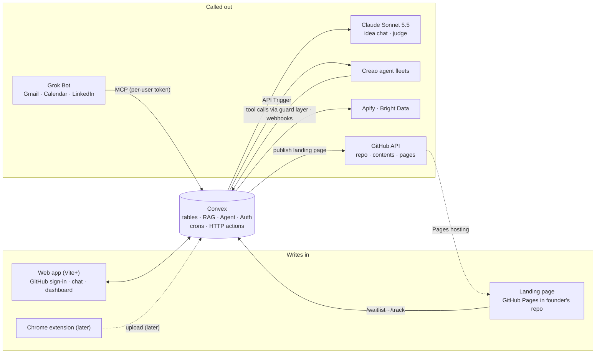
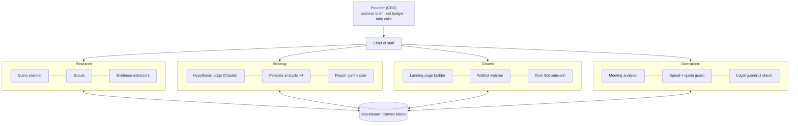

# FounderHub — Cal Hacks 13.0 Spec

Oct 24, 2026 · @Mark

## Summary

A founder types an idea, chats for two minutes, and a fleet of agents spends the next hours proving or disproving it with cited evidence. The output is a live dashboard: every hypothesis with a confidence score backed by sources, a customer list, and a sourced TAM/SAM/SOM.

**Product: FounderHub.** Built first for Berkeley student founders. They should spend most of their time building, but they still need to understand how market analysis works to become good founders. FounderHub does the research legwork and shows its work: every score comes with the quotes behind it, and every market number explains which technique produced it (top-down, bottom-up, customer interviews, demand tests).

**Verdict on the idea:** strong for Cal Hacks. It is a real pain (founders skip validation because it is tedious), it shows multi-agent work that runs on its own, and it fits Creao's one-person-company thesis almost word for word. The risk is scope, not the idea: ten moving parts for one person in about 30 hours.

**The demo moment to build everything around:** hypothesis confidence bars moving live on screen as Reddit threads, market reports and a real interview transcript land in the database, each with a clickable source.

## Decisions so far

| Decision          | Choice                                                                                                                                                                                                                                                                                                  | Why it matters                                                                                    |
| ----------------- | ------------------------------------------------------------------------------------------------------------------------------------------------------------------------------------------------------------------------------------------------------------------------------------------------------- | ------------------------------------------------------------------------------------------------- |
| Name and audience | FounderHub, for Berkeley student founders first                                                                                                                                                                                                                                                         | They spend most of their time building and learn market analysis by reading what FounderHub finds |
| Team              | Solo                                                                                                                                                                                                                                                                                                    | Eligible for Best Solo Hack and Creao's Best One-Person Company; scope must be ruthless           |
| Scope             | Every pillar is built now; only the Chrome extension and Cartesia transcription are scheduled for later                                                                                                                                                                                                 | Every pillar needs a seeded fallback in case a live call fails mid-demo                           |
| Demo              | Live start (idea → brief → approve → scouts fetch → bars move), then cut to a seeded **FounderHub-on-FounderHub** project for replies, calls and rescoring                                                                                                                                              | Anything a human must do (reply, take a call) is pre-seeded; the research loop is live            |
| Auth              | Convex Auth with GitHub OAuth, scopes `read:user user:email repo`                                                                                                                                                                                                                                       | One sign-in also gives the token to publish the landing page to the founder's GitHub              |
| Models            | Claude Sonnet 5.5 (own API credits) for the idea chat and hypothesis judge; Creao runs the scouts, extractors and personas                                                                                                                                                                              | Real Claude use for the Anthropic track                                                           |
| Hypothesis view   | Supporting and disproving quotes first, score second                                                                                                                                                                                                                                                    | Founders trust words they can read, not a number                                                  |
| Landing pages     | One page, written by a Creao agent, pushed to a new repo in the founder's GitHub and hosted on GitHub Pages; waitlist and analytics post to Convex                                                                                                                                                      | No landing route in the Vite+ app; variants become a roadmap slide                                |
| Outreach          | Grok Bot (simple plan) sends from the founder's personal Gmail and LinkedIn, driven by Convex events, with strict daily caps. By default it only messages waitlist signups and contacts the founder adds by hand; scraped people are logged but not contacted unless the founder turns on cold outreach | We build the events, data and skill; Grok Bot does every send                                     |
| Meetings          | Now: a placeholder "Upload recording" button, plus pasted or seeded transcript text that runs the full analysis pipeline. Later: Chrome extension recording + Cartesia Ink transcription                                                                                                                | The interview step of the loop still works in the demo                                            |
| Agents            | Creao agent fleets that call FounderHub's tools, with legal guardrails in the tool layer                                                                                                                                                                                                                | Agents act on their own but can't do anything off-limits                                          |
| Budget            | Founder sets a credit budget per project                                                                                                                                                                                                                                                                | Caps cost and doubles as a willingness-to-pay signal                                              |
| Stack             | Vite+ (`vp`) front end, Convex backend, Apify + Bright Data for fetching, Vertex AI `gemini-embedding-001` (768 dims via `outputDimensionality`) for RAG embeddings (GCP API key in `GOOGLE_GEMINI_API_KEY`, `aiplatform.googleapis.com/v1/publishers/google/models/{model}:predict`)                   | Convex real-time queries make the live dashboard nearly free                                      |

## Founder journey

The founder's active time is about five minutes plus the interviews; everything else runs unattended.

0. **Sign in with GitHub.**
1. **Type the idea.** One sentence is enough.
2. **Chat for 2–3 minutes.** The idea agent asks who it is for, what they do today, what they would pay, and why now. It writes back an **Idea Brief**: problem, target customer, solution, business model, and 5–8 testable hypotheses. The founder edits or approves.
3. **Approve and connect Grok Bot.** One click starts the research and landing-page fleets and takes the founder to the **Customers** tab, which shows a "Connect Grok Bot" card:
   - Scout agents pull market reports, public data and Reddit/forum reactions into the evidence store.
   - The landing-page agent writes one page with a waitlist; FounderHub pushes it to the founder's GitHub and turns on Pages.
   - The founder copies the setup prompt (MCP URL and a fresh token already filled in) into Grok Bot. Grok Bot runs once immediately, then every 15 minutes. Outreach events queue until it connects; the card's status pill turns "Connected" on the first `get_daily_quota` call.
4. **Show up to calls.** Invites land on the founder's calendar. After the call, the founder pastes the transcript into the meeting row (recording upload is a placeholder for now); quote extraction, the summary and the thank-you email happen on their own.
5. **Watch the dashboard.** Hypothesis scores, the customer table and the market sizing update live as evidence arrives. Persona agents re-run the report on a schedule.
6. **Add or change hypotheses anytime.** A new hypothesis is scored against everything already collected, then the scouts go looking for what is missing.

## System architecture

Convex is the system of record and the only thing every part talks to; Creao, the scrapers and Grok Bot never talk to each other directly.



The web app, the landing page (via `/waitlist` and `/track`) and, later, the extension write into Convex. On the other side, Convex calls Claude, triggers Creao agents and scrapers, publishes the landing page through the GitHub API, and serves the MCP tools Grok Bot uses to reach customers. Results come back through Convex HTTP actions, so the dashboard updates the moment anything lands.

## Multi-agent coordination (the showcase)

The story for judges: FounderHub runs a one-person company like a startup team. The founder is the CEO, a chief-of-staff agent manages four agent teams, and every team coordinates through one shared blackboard in Convex.



No agent calls another directly; they read and write the blackboard, so every handoff is visible on screen and can be replayed.

### How the agents coordinate

- **Chief of staff (Creao agent, every 5 minutes via a Convex cron; skipped when the project is paused, over budget, or nothing changed).** Reads hypothesis scores, quote counts, open tasks, spend and quota, then creates or reprioritises tasks. It moves budget toward the hypotheses with the fewest quotes.
- **Task board.** A `tasks` table with owner team, priority, budget and status. Agents claim tasks in a Convex mutation, which is transactional, so two agents never grab the same task.
- **Handoffs are events.** Scout finishes → `evidence.fetched` → extractors start. Extractor adds quotes → `hypothesis.changed` → judge rescores. Judge flags a gap → `hypothesis.needs_interviews` → Grok Bot prioritises those contacts. Meeting uploaded → `meeting.ended` → meeting analyzer.
- **Disagreement is explicit.** When two persona analysts disagree about a hypothesis, the chief of staff opens a debate task; the judge settles it and must cite quotes from both sides.
- **Guards run on every action.** The Operations team checks spend, daily quotas and legal rules before any tool call goes out.
- **The founder only makes founder decisions:** approve the brief, set the budget, show up to calls.

### Who reads, writes and remembers what

Every agent writes to the shared blackboard (the Convex tables) and keeps a small memory of its own, so it improves run to run without re-reading everything.

| Agent                     | Team       | Job                                           | Reads                             | Writes                               | Remembers (own context)            |
| ------------------------- | ---------- | --------------------------------------------- | --------------------------------- | ------------------------------------ | ---------------------------------- |
| Chief of staff            | Lead       | Assigns tasks, splits budget                  | Scores, tasks, spend, quotas      | `tasks`, budget splits               | Which teams deliver fastest        |
| Query planner             | Research   | Turns hypotheses into searches                | Idea Brief, `hypotheses`          | Search tasks                         | Queries that found good quotes     |
| Scouts                    | Research   | Fetch pages, threads, reports                 | Search tasks                      | `sources`, RAG chunks                | Sources already fetched, dead ends |
| Evidence extractors       | Research   | Pull quotes from sources                      | New `sources`                     | `evidence` (quotes + stance)         | Speakers and duplicate quotes      |
| Hypothesis judge (Claude) | Strategy   | Rescores using cited quotes                   | `evidence` per hypothesis         | Scores, top for/against quotes       | Past verdicts and reasons          |
| Persona analysts (4)      | Strategy   | Challenge from four viewpoints                | `hypotheses`, `evidence`          | Critiques, debate tasks              | Their previous objections          |
| Report synthesizer        | Strategy   | Merges findings into report                   | Scores, critiques, market data    | `reports` (new version)              | Last report, to diff               |
| Landing-page builder      | Growth     | Writes and updates the page                   | Idea Brief, `pageEvents`          | `index.html` (pushed to GitHub)      | Copy that converted best           |
| Waitlist watcher          | Growth     | Turns signups into contacts                   | Waitlist posts                    | `contacts`, `waitlist.signup` events | Signup rate trend                  |
| Grok Bot outreach         | Growth     | Emails, DMs, books, thanks                    | `events`, `contacts`, quotas      | `touches`, `meetings`, replies       | Who replied, who declined          |
| Meeting analyzer          | Operations | Extracts interview quotes (transcribes later) | Pasted transcript (audio later)   | Transcript, `evidence`, summary      | Questions that drew answers        |
| Spend + quota guard       | Operations | Blocks over-budget or over-cap actions        | `toolCalls`, `quotaUsage`, budget | Allow/deny on each call              | Today's spend per team             |
| Legal guardrail check     | Operations | Refuses off-limits tool calls                 | Every tool call                   | `toolCalls` audit row                | Domains and actions refused        |

Each agent's memory is a small row in an `agentMemory` table (agent, projectId, notes, updatedAt) that is passed back in its `inputs` on the next Creao run.

### The loop to demo (one hypothesis, end to end)

1. The Skeptical VC persona flags "Students will pay $20 a month" as weak: two quotes, both from Reddit.
2. The chief of staff creates two tasks: Research looks for pricing discussions; Growth gets a `hypothesis.needs_interviews` event.
3. Scouts pull pricing threads; extractors add five quotes, three of them disproving.
4. Grok Bot books a call; after it, the meeting analyzer adds the interviewee's own words on price.
5. The judge rescores, the hypothesis page shows the new quotes, and the report's "what changed" section explains why.

### Make it visible

The **fleet panel** is a live version of the chart above. Each agent lights up while it runs, a handoff feed scrolls beside it ("Chief of staff → Growth: prioritise 4 contacts", "Scout → Extractors: 12 Reddit threads"), and each team shows its spend. Put it on screen during the demo's live start.

### Sample event log (the pricing loop)

What the handoff feed shows during the demo, oldest first. One weak hypothesis goes from flagged to rescored with no founder input except taking the call.

| Time  | Agent                 | Event                            | Blackboard change                                        |
| ----- | --------------------- | -------------------------------- | -------------------------------------------------------- |
| 10:00 | Skeptical VC persona  | Flags pricing hypothesis as weak | Critique added: 2 quotes, both Reddit                    |
| 10:01 | Chief of staff        | Opens two tasks                  | Research: find pricing talk · Growth: interview priority |
| 10:01 | Chief of staff        | Moves $3 to Research             | Budget split updated                                     |
| 10:02 | Query planner         | Plans 6 pricing searches         | 6 search tasks                                           |
| 10:04 | Scouts                | Fetch 14 threads, 2 reports      | 16 `sources`, chunks embedded                            |
| 10:06 | Legal guardrail check | Skips one login-walled page      | `toolCalls`: refused, reason logged                      |
| 10:07 | Evidence extractors   | Add 5 pricing quotes             | 2 supports, 3 disproves                                  |
| 10:08 | Hypothesis judge      | Rescores pricing hypothesis      | 62% → 41%, new top "against" quote                       |
| 10:08 | Chief of staff        | Raises interview priority        | `hypothesis.needs_interviews` event                      |
| 10:15 | Grok Bot outreach     | Emails 3 matching students       | 3 `touches`, quota 12 left                               |
| 13:40 | Grok Bot outreach     | Books call from reply            | `meetings` row, calendar invite                          |
| 16:32 | Meeting analyzer      | Processes 28-minute call         | Transcript, 4 new quotes                                 |
| 16:33 | Hypothesis judge      | Rescores again                   | 41% → 33%                                                |
| 16:34 | Report synthesizer    | Publishes report v7              | "What changed": pricing weaker                           |
| 16:45 | Grok Bot outreach     | Sends personal thank-you         | `touches`, `meeting.analyzed` acked                      |

The numbers are illustrative; in the demo they come from the seeded project.

## Pillar specs

### 1. Idea chat

- **Where it runs:** in the web app, streaming through the Convex Agent component (`@convex-dev/agent`) with Claude Sonnet 5.5 (`claude-sonnet-5-5`, own API key in a Convex env var), which stores the chat thread in Convex.
- **Output:** an `ideaBrief` record plus 5–8 `hypotheses`, each typed: _problem_, _customer_, _willingness to pay_, _channel_, _competition_, _market size_.
- **Rule:** every hypothesis must be falsifiable and say what evidence would disprove it ("Fewer than 1 in 10 interviewees say they spend 2+ hours a week on X").

### 2. Data collection fleet (Creao + Apify + Bright Data)

Convex orchestrates; Creao agents do the thinking; Apify and Bright Data do the fetching.

1. **Query planner (Creao agent).** Input: the Idea Brief. Output: search queries, subreddits, competitor names and public data sources per hypothesis.
2. **Fetch (Convex actions).**
   - Apify: a Reddit scraper actor for threads and comments; Website Content Crawler for report pages and competitor sites; Google Search scraper for discovery.
   - Bright Data: SERP API for search; Web Unlocker for pages that block bots; ready-made datasets for LinkedIn profiles, Crunchbase companies and Reddit posts.
   - Public data: Census/BLS counts, SEC filings, public summaries of market reports. Paywalled reports are cited by their public summary only.
3. **Ingest.** Raw documents are chunked and embedded into the Convex RAG component (`@convex-dev/rag`), namespaced per project, with filters for source type and hypothesis.
4. **Evidence extractor (Creao agent, several in parallel).** Reads retrieved chunks for one hypothesis and returns evidence items: a quote under 300 characters, source URL, stance (supports / contradicts / neutral) and a confidence from 0 to 1. An item without a URL and quote is dropped.

**How Creao is called:** each agent is a Creao agent started through its API Trigger (`POST https://agent.creao.ai/api/v1/apps/{appId}/runs` with `inputs` and a `webhookUrl`). Creao agents can call tools mid-run, so scouts call FounderHub's own tool endpoints on Convex (`search_web`, `scrape_page`, `run_actor`, `add_evidence`) instead of hitting Apify or Bright Data directly. Results also return to a Convex webhook. Run several agents in parallel to make the fleet visible.

**Legal guardrails, enforced in the tool layer, not just the prompt.** Every Creao tool call goes through Convex, which refuses anything outside these rules:

- Public pages only. No content behind a login or paywall, and no reusing anyone's session cookies.
- Respect `robots.txt` and site rate limits; one request per domain per few seconds.
- Market reports: cite public summaries and press releases; never copy full paywalled reports.
- People data: only public professional info (name, role, company, public profile URL, work email from public pages). No home addresses, phone numbers, or sensitive categories (health, religion, politics, and so on).
- Store quotes short and attributed, with a link back. Delete a person's data when they ask.
- Every agent prompt includes: "If an action could be illegal, deceptive, or against a site's terms, do not do it; log it as skipped with a reason."
- An audit log of every tool call (agent, tool, target, allowed or refused) is visible to the founder.

**Spend budget per project.** The founder picks a budget at the start (for example $5, $20 or $50 of agent and scraping credits). A spend meter on the dashboard shows credits used per agent and per source; agents pause at the cap and ask to continue. The budget a founder picks is also a signal of what founders would pay for FounderHub itself.

### 3. Hypothesis engine (grounded RAG)

- **Quotes first, score second.** Each hypothesis is judged by the actual words people and sources used. The founder sees two columns: quotes that **support** it and quotes that **disprove** it, each with who said it, where, when, and a link.
- Each hypothesis gets its own RAG search over the evidence store, then a Claude Sonnet 5.5 judge (a Convex action) that must cite a quote and source for every claim. No quote, no claim.
- **Strongest for and strongest against:** the judge picks the single most convincing quote on each side and writes one line on why it matters. These two quotes sit at the top of the hypothesis page.
- **Missing evidence is shown too:** "No interviewee has mentioned price yet" tells the founder what to ask next.
- The score below is only a summary of the quotes; it never appears without them:

```latex
\text{score} = \sigma\Big(\sum_i w_{\text{source}(i)} \cdot s_i \cdot c_i\Big)
```

- _s_ is +1 for a supporting quote and −1 for a disproving one; _c_ is the extractor's confidence; _w_ weights the source: interview 3, waitlist behaviour 2.5, cold-email or LinkedIn reply 2, report or public data 1.5, Reddit/forum 1. Show the weights on the page so judges see the reasoning.
- Show **evidence strength** (number and variety of sources) next to the score; a 90% score from three Reddit comments should look weak.
- **Updates:** any new evidence row triggers a Convex scheduled function that rescores the affected hypotheses and adds the new quote to the right column with a "new" tag. A hypothesis with few quotes creates a task for the scouts and raises its contacts' priority in the outreach queue.

### 4. Landing page + waitlist

- **Build.** A Creao agent writes one static `index.html` from the Idea Brief, with the form and the analytics script inline.
- **Publish (Convex action, the founder's GitHub token).** `POST /user/repos` creates the public repo `{slug}-landing`, `PUT /repos/{owner}/{repo}/contents/index.html` pushes the page, and `POST /repos/{owner}/{repo}/pages` turns on Pages from `main`. That last call needs the `repo` scope. Updates push a new commit to the same file. The landing card shows "Publishing… (about 1 min)" until the Pages URL responds.
- **Waitlist.** The form posts to the Convex HTTP action `/waitlist?project={slug}` with email, role, company size and one free-text "what would you use this for?". Signups become customer rows (origin: _waitlist_), a `waitlist.signup` event, and evidence for the willingness-to-pay and channel hypotheses. Grok Bot sends the welcome; the page never sends mail.
- **Analytics.** A ~20-line inline script sends `pageview` (referrer and UTM), `form_focus` and `signup` to `/track?project={slug}`. A random visitor ID lives in `sessionStorage`; no cookies, no stored IPs, no third-party tools. Rows go to `pageEvents`. The landing card shows visits, unique visitors, form starts, signups and conversion rate live; conversion feeds the SOM.
- **Public endpoint guards.** Both endpoints answer CORS preflight (`OPTIONS`) for the project's Pages origin only, reject other `Origin` headers, rate-limit per hashed IP with `@convex-dev/rate-limiter` (e.g. 10 signups an hour), and drop duplicate emails per project, so junk doesn't pollute the evidence.

### 5. Outreach via Grok Bot (our skill + MCP server)

FounderHub never sends anything itself. Convex publishes **events** and serves data; Grok Bot reacts to events and does all sending from the founder's personal Gmail and LinkedIn.

- **Event outbox in Convex.** Anything that needs a human touch writes a row to the `events` table. Event types:
  - `contacts.queued`: new people to reach. Only contacts with origin _waitlist_ or _manual_ by default; scraped contacts (origin _scout_) are logged as "Found, not contacted" and appear here only while the project's **cold outreach** toggle is on (off by default)
  - `waitlist.signup`: someone joined the waitlist; send a welcome and an interview invite
  - `meeting.ended`: the recording is uploaded; nothing to send yet
  - `meeting.analyzed`: the transcript is processed; send a thank-you with one specific line from the call
  - `hypothesis.needs_interviews`: a hypothesis has too few quotes; prioritise matching contacts
- **How Grok Bot receives events.** The setup prompt makes Grok Bot run the skill once immediately, then create a routine that runs every 15 minutes, so a thank-you goes out at most about 15 minutes after a call is analysed. Each run calls `get_pending_events`. On stage, type "run FounderHub outreach" to trigger a run by hand. Webhook routines can be added later without changing the skill.
- **MCP server on Convex** (HTTP actions, public URL, bearer token). Each user generates a personal token on the Settings page or the Connect card; it is stored hashed, can be revoked, and every tool is scoped to that user's projects. Tools:
  - `get_pending_events(limit)` and `ack_event(eventId, result)`
  - `get_daily_quota()` → what is left today per channel, so the bot never has to count
  - `get_contact(contactId)` → name, role, email or LinkedIn URL, why they match, a personal hook
  - `get_interview_brief(projectId)` → the idea in two sentences, questions to ask, the founder's free slots
  - `log_touch(contactId, channel, kind, text)` for sends, replies, connection requests and DMs (replies are stored as evidence)
  - `log_meeting(contactId, startTime, meetLink)`
  - `get_meeting_summary(meetingId)` → one personal line for the thank-you
- **Daily limits, enforced twice.** Convex refuses `log_touch` past the cap, and the skill tells Grok Bot to check `get_daily_quota` first. Defaults below are deliberately low; change them in the project settings.

| Action                       | Daily cap | Notes                                            |
| ---------------------------- | --------- | ------------------------------------------------ |
| New cold emails              | 15        | Spread across the day, at least 10 minutes apart |
| Email follow-ups             | 10        | One follow-up per person, at least 3 days later  |
| LinkedIn connection requests | 10        | With a short note                                |
| LinkedIn DMs                 | 10        | Only to accepted connections                     |
| Thank-you emails             | No cap    | Only to people who were actually interviewed     |
| Calendar invites             | 5         | Only for slots the founder marked free           |

- **Not looking like spam from a personal Gmail:** plain text only; no tracking pixels, attachments or link shorteners; at most one link (the landing page) and none in the first email; under 120 words; a first line written for that person; the founder's real name and school; and a closing line such as "If this isn't relevant, just reply 'no' and I won't follow up." Stop all cold email for the day if two messages bounce.
- **LinkedIn:** you've chosen to let Grok Bot send connection requests and DMs. LinkedIn restricts accounts that behave like automation, so the low caps and human-paced timing above also protect your account.

**Grok Bot setup prompt** (shown on the Connect card with the URL and token filled in):

```markdown
Connect the MCP server at {mcpUrl} with bearer token {token} as "FounderHub".
Then add the skill below as "FounderHub customer discovery", run it once now,
and create a routine that runs it every 15 minutes. Report what you did.
```

**Grok Bot skill: "FounderHub customer discovery"** (paste as the skill's instructions):

```markdown
# FounderHub customer discovery

## When to use

When a routine fires, a FounderHub webhook arrives, or I say "run FounderHub outreach".

## Access needed

FounderHub MCP connector, Gmail and Google Calendar (my personal account), LinkedIn (logged in as me).

## Steps

1. Call get_daily_quota. If every channel is at 0, stop and report "Daily limit reached".
2. Call get_pending_events(limit: 10). Handle the oldest first.
3. For each event:
   - contacts.queued: call get_contact. If they have a work email and email quota remains, send a
     cold email. Otherwise, if LinkedIn quota remains, send a connection request with a short note.
   - waitlist.signup: send a thank-you for joining and offer a 20-minute call.
   - meeting.ended: do nothing; ack it.
   - meeting.analyzed: call get_meeting_summary and send a thank-you that mentions one specific
     thing they said and confirms their input was received.
   - hypothesis.needs_interviews: move those contacts to the front of today's sends.
4. Check Gmail and LinkedIn for replies to FounderHub messages. Log each reply with log_touch.
   If they want to talk, offer two slots from get_interview_brief and, once they pick one, create a
   Google Calendar event with a Meet link and call log_meeting.
5. After every send, call log_touch. Then call ack_event with what you did.

## Writing rules

Plain text. Under 120 words. Open with why I'm writing to this person specifically. Say I'm a
Berkeley student founder doing research, not selling. No links in a first email; at most one link
later. End with: "If this isn't relevant, just reply 'no' and I won't follow up."

## Hard limits (never break)

- Never exceed get_daily_quota for any channel. Space sends at least 10 minutes apart.
- At most one follow-up per person. Never contact someone who said no or didn't accept on LinkedIn.
- Only email addresses and profiles returned by FounderHub.
- Stop cold email for the day after 2 bounces.
- Never make claims about the product that aren't in the interview brief. Never pretend to be human
  if asked directly; say it's sent with an assistant on my behalf.

## Approval

Auto-review rule: allow sending from my Gmail and LinkedIn only to recipients returned by FounderHub
tools, within quota. Ask me first for anything else.

## Report

After each run, post: sends by channel, replies, meetings booked, quota left, anything skipped and why.
```

### 6. Meeting recording and analysis (Chrome extension + background jobs)

**Now:** the meeting row has an "Upload recording" button that only says "Coming soon", plus a "Paste transcript" box. Saving a transcript writes `meeting.ended` and runs steps 5–6 below unchanged. The seeded demo project ships with transcripts. **Later:** steps 1–4 (the extension and Cartesia transcription).

Record the whole call, upload it once, analyse it in the background. Nothing has to work in real time during the interview.

1. **Record.** Manifest V3 extension scoped to `meet.google.com`. It captures the Meet tab with `chrome.tabCapture` and the founder's mic with `getUserMedia` inside an **offscreen document**, so recording survives the popup closing. Two separate tracks: mic = founder, tab = interviewee. That gives speaker labels for free.
2. **Upload.** When the call ends, the extension gets a short-lived upload URL from Convex (`ctx.storage.generateUploadUrl()`) for each track and POSTs both audio files (WebM/Opus, roughly 15 MB for a 30-minute call). The returned storage IDs are saved on the meeting. If the upload fails, files stay in IndexedDB and retry. Cost: Convex's free plan includes 1 GB of file storage (about 60 interviews), then about $0.03 per GB per month.
3. **Event.** Convex records the upload, matches the Meet code to the meeting Grok Bot booked, and writes `meeting.ended`.
4. **Transcribe (background).** A Convex scheduled action sends each track to Cartesia Ink's batch transcription endpoint, then merges the two transcripts by timestamp into one speaker-labelled transcript.
5. **Analyse (background).** The transcript goes into the RAG store; the evidence extractor pulls supporting and disproving quotes per hypothesis; a summary agent writes a short call summary and one personal line for the thank-you. Then Convex writes `meeting.analyzed`.
6. **Thank-you.** Grok Bot picks up `meeting.analyzed` and sends the thank-you from the founder's Gmail.

- **Consent:** when recording starts, the extension posts "This call is recorded and transcribed for research; tell me if you'd rather not" in the Meet chat, and shows a REC badge with one-click stop. California requires everyone's consent to record.
- **Security:** files in Convex storage are private, upload URLs are short-lived, and the Cartesia key lives only in a Convex environment variable.

### 7. Persona agents + living report

- Four Creao agents with fixed personalities question the RAG store on a schedule (every 30 minutes, and on demand). Like the chief-of-staff cron, the schedule skips a project that is paused, over budget, or has no new evidence since that persona's last run:
  - **Skeptical VC:** why will this not be a venture-scale business?
  - **Target customer:** would I switch from what I use today?
  - **Industry analyst:** what do the numbers say about size and growth?
  - **Competitor PM:** how would I copy or crush this?
- Each writes findings with citations. A synthesis agent merges them into the report: what is validated, what is shaky, the next three experiments. Every version is saved so the founder can see how the picture changed.

## Dashboard

Three tabs, all live through Convex queries, plus the report.

### Hypotheses

- **Board:** one card per hypothesis showing its strongest supporting quote and strongest disproving quote, with a small score bar underneath. Sorted by "most uncertain" so the founder sees where to dig.
- **Per-hypothesis page:**
  - two columns of quote cards: **Supports** and **Disproves**. Each card has the quote, speaker or source ("PM at a 40-person startup, interview Oct 25" or "r/startups, 212 upvotes"), source type, date and link
  - filters by source type: interviews, replies, waitlist answers, Reddit, reports
  - "What we still don't know" and the next question to ask in interviews
  - score over time, each jump labelled by the quote that caused it
  - persona agents' comments on this hypothesis
  - buttons to edit the hypothesis or ask the scouts for more data

### Customers (display only)

The founder lands here right after approving the brief. At the top: the **Connect Grok Bot** card (setup prompt with a copy button, "Connected" status pill), the **Landing page** card (Pages URL, publish status, visits, unique visitors, form starts, signups, conversion), the **cold outreach** toggle (off by default), and an "Add contact" button for people the founder knows.

Below that, a spreadsheet-style table, read-only, one row per person.

| Column              | Example values                                                                             |
| ------------------- | ------------------------------------------------------------------------------------------ |
| Name, role, company | Taken from the source                                                                      |
| Source              | Found online · Waitlist · Added by founder                                                 |
| Status              | Found, not contacted · Queued · Emailed · Replied · Meeting booked · Interviewed · Thanked |
| Fit score           | Match to the target customer in the Idea Brief                                             |
| Key quote           | Best line from their reply or interview, linked to the evidence                            |
| Last touch          | Date of the last Grok Bot action                                                           |

### Market (TAM / SAM / SOM)

Two methods side by side, every number clickable to its source.

- **Top-down:** total market from reports and public data → share that matches the segment → share reachable by the go-to-market.
- **Bottom-up:** number of target customers (counts from Census/BLS, company datasets, LinkedIn data) × expected price from interviews and the waitlist survey.
- **SOM:** SAM × a capture rate tied to observed waitlist conversion, not a guess.
- Show the gap between the two methods. A big gap is a finding, not a bug, and judges will respect that.

### Report

The persona synthesis, versioned. Latest version on top with a "what changed since last run" summary.

## Convex data model

Eighteen app tables plus Convex Auth's `authTables`; the RAG component holds the embedded chunks separately, namespaced by `projectId`.

**GitHub token capture (verified against the Convex Auth docs).** The provider's `profile(githubProfile, tokens)` callback receives the OAuth tokens, and any field it returns is saved on `users` when the custom `users` schema declares it:

```ts
GitHub({
  authorization: { params: { scope: "read:user user:email repo" } },
  profile(p, tokens) {
    return {
      id: String(p.id),
      name: p.name ?? p.login,
      email: p.email,
      image: p.avatar_url,
      githubLogin: p.login,
      githubToken: tokens.access_token,
    };
  },
});
```

Every sign-in refreshes the stored token. No query returns `githubToken` to the client; only the publish action reads it.

| Table         | Key fields                                                                                                                             | Written by                                             |
| ------------- | -------------------------------------------------------------------------------------------------------------------------------------- | ------------------------------------------------------ |
| `users`       | (Convex Auth fields), githubLogin, githubToken                                                                                         | Convex Auth sign-in                                    |
| `mcpTokens`   | userId, tokenHash, createdAt, lastUsedAt, revokedAt                                                                                    | Settings page / Connect card                           |
| `projects`    | userId, slug, ideaText, status (active, paused), budgetUsd, dailyCaps, coldOutreach, grokConnectedAt, landingRepo, pagesUrl, createdAt | Web app, publish action, MCP                           |
| `ideaBriefs`  | projectId, problem, customer, solution, model, version                                                                                 | Idea chat agent                                        |
| `hypotheses`  | projectId, type, statement, disproveIf, score, strength, topSupportId, topDisproveId, scoreHistory\[\]                                 | Idea agent, founder, rescoring job                     |
| `sources`     | projectId, url, sourceType (report, public data, reddit, web, interview, email, linkedin, waitlist), fetchedAt, ragKey                 | Fetch tools, background jobs, MCP                      |
| `evidence`    | projectId, hypothesisId, sourceId, quote, speaker, stance (supports, disproves), confidence, weight                                    | Evidence extractor agents                              |
| `contacts`    | projectId, name, role, company, email, linkedinUrl, origin (scout, waitlist, manual), status, fitScore, keyQuote                       | Scouts, waitlist, founder, Grok Bot via MCP            |
| `touches`     | contactId, channel (email, linkedin), kind (send, follow-up, reply, connection, thank-you), at, text                                   | Grok Bot via MCP                                       |
| `meetings`    | contactId, startTime, meetCode, transcriptText, audioFileIds\[\] (later), transcriptSourceId, summary, status                          | Grok Bot, founder (pasted transcript), background jobs |
| `tasks`       | projectId, team (research, strategy, growth, operations), title, priority, budgetUsd, status, claimedBy, createdBy                     | Chief-of-staff agent; claimed by team agents           |
| `events`      | projectId, type, payload, status (pending, done, skipped), createdAt, ackedAt, result                                                  | Convex jobs and agents; acked by Grok Bot or agents    |
| `agentRuns`   | projectId, agent, team, taskId, creaoRunId, status, costUsd, startedAt, finishedAt                                                     | Orchestrator, Creao webhooks                           |
| `toolCalls`   | agentRunId, tool, target, allowed, reason, costUsd                                                                                     | Convex tool layer (audit log)                          |
| `quotaUsage`  | projectId, date, channel, count                                                                                                        | MCP `log_touch`                                        |
| `reports`     | projectId, version, body, personaNotes\[\], createdAt                                                                                  | Persona synthesis agent                                |
| `agentMemory` | agent, projectId, notes, updatedAt                                                                                                     | Each agent at the end of its run                       |
| `pageEvents`  | projectId, type (pageview, form_focus, signup), visitorId, referrer, utm, at                                                           | `/track` and `/waitlist` HTTP actions                  |

`agentRuns` powers a live "fleet" panel: which agents are running right now. It costs an hour and makes the multi-agent story visible to judges.

## Demo plan (3–5 minutes)

1. **Live start (about 2 minutes).** Sign in with GitHub, type a fresh idea, chat through the brief, approve. Show the fleet panel lighting up, scouts fetching and the first quotes landing with bars moving. Paste the Grok Bot setup prompt and show the pill turn "Connected"; the landing page starts publishing to GitHub Pages.
2. **Cut to the seeded project.** FounderHub validating FounderHub ("Students will pay $20 a month"). Walk through the pricing loop from the sample event log: Skeptical VC flag → tasks → new quotes → the seeded interview transcript → 62% → 41% → 33%, and the report's "what changed".
3. **Close.** Customers tab (real waitlist signups and landing analytics), the market tab's two methods and their gap, and the audit log of refused tool calls.

## Sponsor tracks

Go deep on five tracks you already use; consider a few more only if the fit is real. Prize details are from the Cal Hacks 13.0 judging guide (Oct 21) and may change.

### Primary targets

| Track                                                    | Prize                                        | How FounderHub scores                                                                                                        |
| -------------------------------------------------------- | -------------------------------------------- | ---------------------------------------------------------------------------------------------------------------------------- |
| Creao: Best AI-First Disruptor / Best One-Person Company | $5,000 across three tracks + CREAO Launchpad | The product is literally "one founder does a research team's work." Show the agent fleet panel and the API-triggered runs    |
| Apify: Best Use of Apify                                 | $2,000 / $1,000 / $800 / $400 / $400         | Several actors feed real evidence; judged on meaningful use plus overall quality                                             |
| Apify: Best Actor                                        | $400                                         | Publish your own actor, e.g. "Founder pain-point finder" that pulls complaint threads across Reddit and forums for a keyword |
| Bright Data                                              | Not announced yet                            | SERP, Web Unlocker and LinkedIn/Crunchbase datasets; check the Live Site for criteria                                        |
| Convex: Best Use of Convex                               | EP-133 K.O. II + ESP32-S3 display            | Real-time dashboard, RAG and Agent components, scheduled rescoring, HTTP actions as the MCP server and webhooks              |
| Cal Hacks: Best Solo Hack                                | AirPods Pro 3                                | You are solo                                                                                                                 |
| Cal Hacks: Most Technically Complex / Overall            | NuPhy Air60 HE / top three prizes            | Many agents, two external agent platforms, an extension and a live score                                                     |

### Worth considering

| Track                               | Fit            | What it would take                                                                                                                                                                         |
| ----------------------------------- | -------------- | ------------------------------------------------------------------------------------------------------------------------------------------------------------------------------------------ |
| Anthropic                           | Strong         | Judges want a named community and a problem you lived. Pitch it for student founders at hackathons like this one; use Claude for the judge or persona agents and explain its failure modes |
| Microsoft: Built for the Real World | Medium         | Wants a production-minded agent for productivity; stress the citations, approval rules and consent                                                                                         |
| Cartesia                            | Weak to medium | Criteria require voice to be core. Transcription is a side feature, so only enter if you use Ink for transcription anyway                                                                  |
| Elastic                             | Unknown        | Criteria not out yet; Elastic could replace Convex RAG for search if their criteria reward it (don't switch mid-build)                                                                     |

### Poor fit (skip)

- **SpaceXAI "Make it Legendary":** requires a space-data project built with Cursor and the Grok Imagine or Voice API. Using Grok Bot for outreach does not qualify.
- **Visa, Hyphenate, CRS, Capital One:** finance or commerce specific.

## Risks and responsible design

| Risk                                            | Mitigation                                                                                                                                                                                                |
| ----------------------------------------------- | --------------------------------------------------------------------------------------------------------------------------------------------------------------------------------------------------------- |
| Too much to build solo by Sunday 9 AM           | Build a thin slice of every pillar first; seed demo data for each so no single failure kills the demo                                                                                                     |
| Grok Bot simple-plan limits                     | Daily caps in Convex plus explicit limits in the skill; the bot calls `get_daily_quota` before every run and stops at zero                                                                                |
| Personal Gmail flagged as spam                  | Low volume spread through the day, plain text, no tracking or first-email links, personal first line, easy opt-out, stop after 2 bounces                                                                  |
| LinkedIn restricts accounts that look automated | Your call to use Grok Bot for LinkedIn; keep connection requests and DMs at 10 a day, human-paced, and never message people who didn't accept                                                             |
| Creao agents do something illegal               | Guardrails enforced in the Convex tool layer (public pages only, no logins or paywalls, robots.txt, professional data only), an "if in doubt, skip and log" rule in every prompt, and a visible audit log |
| Recording without consent                       | Consent message in Meet chat, REC badge, one-click stop. California requires all-party consent                                                                                                            |
| Agents invent quotes                            | A quote is stored only if it appears in the fetched text or transcript; otherwise it is rejected                                                                                                          |
| A score looks more certain than it is           | Quotes on both sides always shown with the score; call it "confidence," never "accuracy"                                                                                                                  |
| Costs run away                                  | Per-project budget; agents pause at the cap                                                                                                                                                               |
| API keys leak                                   | Keys stay in Convex environment variables; the extension gets short-lived upload URLs from Convex; no keys in the repo                                                                                    |
| GitHub `repo` scope is broad                    | Token stored only in Convex, never sent to the client, used only to create and push to `*-landing` repos. Later: ask for the scope only on a separate "Connect GitHub to publish" step                    |
| Junk on public endpoints                        | `/waitlist` and `/track` check `Origin`, rate-limit per hashed IP, and drop duplicate emails                                                                                                              |
| Messaging strangers from personal accounts      | Cold outreach to scraped contacts is off by default; Grok Bot only messages waitlist signups and contacts the founder adds                                                                                |
| MCP token leaks                                 | Per-user tokens, stored hashed, revocable from Settings, scoped to that user's projects                                                                                                                   |
| Live demo failure (Wi-Fi, rate limits)          | Record a backup demo video; keep a fully seeded project one click away                                                                                                                                    |
